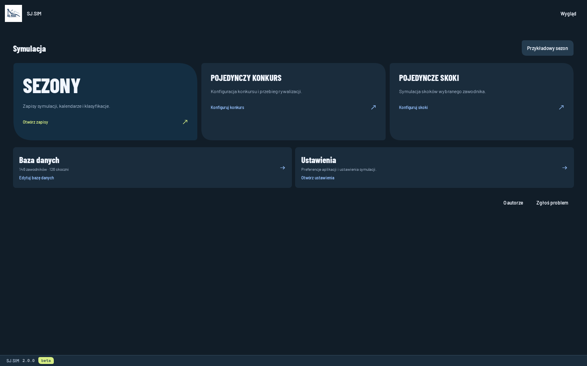
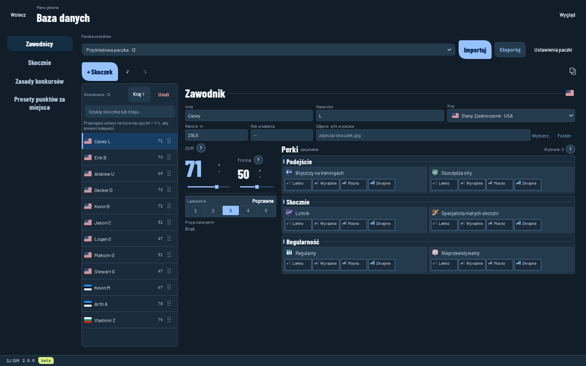

# Sj.Sim

Symulator skoków narciarskich. Układasz sezon, wybierasz skoczków i skocznie, rozgrywasz konkursy. Wyniki zależą od umiejętności, formy, perków, wiatru, belki i lądowania.

- Sezony z własnym kalendarzem, kwalifikacjami i klasyfikacjami.
- Konkursy indywidualne, KO i drużynowe oraz pojedyncze skoki.
- Edytory skoczków, skoczni, zasad i punktacji. Paczki można importować i udostępniać.
- Laboratorium do porównywania wyników i dostrajania symulacji.
- Polski, angielski i czeski. Jasny i ciemny motyw.

## Uruchomienie

Windows: pobierz i uruchom instalator `SjSim-…-Setup.exe`. Linux: pobierz jeden plik `SjSim-….AppImage`, nadaj mu prawo uruchamiania i otwórz. Paczki i zapisy pozostają w `Dokumenty/SjSimData`. [Instalacja, aktualizacje i budowanie wydań](docs/DISTRIBUTION.md).

## Development

C++17, Qt 6 i QML; build przez qmake. [Przygotowanie Windows](docs/WINDOWS_SETUP.MD), [laboratorium](docs/BALANCE_LAB.md), [playground i CLI](docs/PLAYGROUND_V2.md).

GitHub Actions buduje instalator Windows i AppImage dla Linuksa po pushu. Są dostępne w artefaktach workflow; tag `v…` dodatkowo tworzy wydanie. [Lokalna weryfikacja deployu](docs/development/DEPLOY.md).

Paczkę ze zdjęciami i zależnościami udostępnisz jako jeden plik `.sjsim-pack`. [Foldery danych, import i tryb przenośny](docs/RESOURCE_LIBRARY.md).
